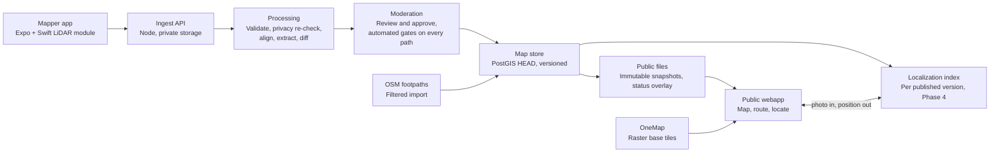
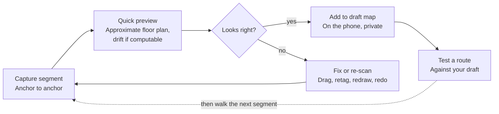

# Underground SG: indoor & underground wayfinding spec

Oct 12, 2026 · Josh Stout · Exported from the living doc: https://claude.ai/code/artifact/39b5bb53-40b8-4b46-ba9c-e6e1c3337f78
(This file is now the source of truth for the codebase. Keep it updated when decisions change.)

## Overview and goals

Underground SG is a free public webapp that shows downtown Singapore's underground pedestrian links (UPLs) and mall interiors on the real street map, tells you where you are, and routes you between two street-level points through the underground. The maps are captured with iPhone LiDAR: by the owner alone through Phase 3, then by contributors too. Edits go live only after moderation, apart from two narrow publish paths that still pass automated checks (see [Crowdsourcing and moderation](#crowdsourcing-and-moderation)).

The gap: UPLs join MRT stations, malls and offices into one network, but no public map shows it as one network across levels. Street maps route on the surface, and mall directories stop at their own walls. A 2025 Hack for Public Good team, [Under Cover](https://www.hack.gov.sg/2025/under-cover/), showed clear demand in Orchard, but built its routes by hand.

MVP goals (targets to validate in the pilot):

- Map the City Hall cluster end to end on the pedestrian network: every public level on it, every exit, escalator and lift.
- Locate a user on the correct level and within about 5 m from a single photo. Response time is measured and reported against a 3 s target; it is not a launch gate.
- Route between any two street points in the cluster, preferring underground or sheltered paths, and avoiding MRT paid areas and links that are closed at the time of travel.
- Publish a contributor's edit within 48 hours of submission, after review (from Phase 4, when contributors join).

## Users and core use cases

Five groups, two of them on the supply side.

| User | What they need | Feature that serves it |
| --- | --- | --- |
| Office workers and commuters | Fastest sheltered path between MRT, office and lunch | Street-to-street routing, "stay underground" toggle |
| Tourists | Find an exit or attraction without knowing mall names | Locate me, exits labelled with the street they open onto |
| Wheelchair users, parents with prams | Step-free routes, lift locations | Step-free routing mode (no stairs or escalators) |
| Contributors | Add a missing corridor or report a closed exit | Mapper app on an iPhone with LiDAR, status edits. Contributors join in Phase 4 |
| Moderators | Keep the live map accurate and safe | Review queue, diff view, rollback: an authenticated route in the webapp |

The owner (Josh) is the only mapper through Phase 3. Who moderates at launch is an open question.

## MVP scope: City Hall cluster

The MVP covers one dense, connected cluster you can walk daily, so drift, positioning and routing are tested on real ground before scaling.

Core venues (boundary to confirm on the site walk):

- City Hall MRT interchange: its public levels on the pedestrian network, and all its exits
- Funan, including the UPL from its Basement 2 to City Hall station
- Raffles City
- CityLink Mall and its link to Esplanade MRT
- Esplanade MRT station exits

Stretch, if the core goes smoothly: Marina Square, Suntec City, Esplanade theatres.

Levels: pedestrian-network levels only. That means basements, the street-level floor and link bridges, plus the vertical connectors (escalators, lifts, stairs) between them.

In scope: public walkways on those levels, exits, escalators, lifts, stairs, fare gates, toilets, and shop names as points of interest. Opening hours of links and exits, and MRT paid-area boundaries, because routing needs them. Street footpaths around the cluster (from OpenStreetMap), so routes can start and end on the street.

Out of scope for MVP:

- a public native app;
- other clusters (Orchard, Raffles Place);
- upper retail floors, office and hotel lobbies;
- live crowd levels, shop opening hours and inventory;
- back-of-house and restricted areas;
- landmark photos in directions, unless landlords' permission covers publishing photos.

## System architecture

Scans flow one way, from the phone through processing to moderation, and only published versions reach the public map. Processing never publishes on its own.

- Blurring happens on the phone, before any image is written. Processing re-checks; it does not blur.
- Approval writes a new immutable version and publishes its files. The localization index is built from each published version, so it only ever holds approved captures.
- The webapp reads only published files: the versioned snapshot, the street graph and the short-lived status overlay. It sends a user's photo to the localization service and gets a position back.
- Status edits (Phase 4) enter the same moderation step. Trusted contributors' status edits publish straight to the status overlay after the automated gates, and never create a map version.
- Through Phase 3 everything except the webapp and the public files runs on the owner's PC (see [Hosting and budget](#hosting-and-budget)).

## Capture app for mappers

Capture is an Expo app (`apps/mapper`, React Native and TypeScript) with one local Swift module, `apps/mapper/modules/capture-native`. A webpage cannot read the LiDAR sensor, and no maintained React Native library exposes ARKit scene reconstruction together with depth and pose export, so that one module is native. The public map stays a webapp. The same app also previews, edits and tests the map (see [Mapper mode](#mapper-mode-the-fast-loop)). Details: [ADR 0001](decisions/0001-mapper-app-and-public-webapp.md) and [ADR 0007](decisions/0007-expo-mapper-app.md).

Who does what:

- **Swift module:** the ARKit session and RealityKit view, keyframe selection, blurring, the bundle writer, floor-triangle export, and packing the bundle for upload. Nothing per frame (images, depth, mesh or per-frame poses) crosses into JavaScript.
- **TypeScript:** every screen, the anchor and tag flows, the drift calculation, the floor-plan preview, the draft store, route tests, upload, and the map. It receives status events about five times a second and compact results such as file paths and floor triangles.

Device: the owner captures with an iPhone 17 Pro Max. Keep iOS current, but avoid iOS 26.4 to 26.6.0, which had a reported LiDAR world-tracking drift regression. Every segment records `os_version` and `device_model`. The iPhone 17 Pro Max is the reference device; an iPad Pro with LiDAR may work but is not tested.

### Anchors

An anchor is a physical feature that can be found again, not the phone's pose at the moment of a tap. There are two kinds:

- **`floor_point`:** a point on the floor at a door threshold or fare-gate line, found by an ARKit raycast, plus the direction it faces.
- **`image_anchor`:** a permanent flat sign that ARKit recognises, which gives a repeatable position and orientation.

Each anchor keeps a private reference photo so mappers can find it again. Street-facing anchors also carry a street prior: a position from LTA's MRT exit data, a phone GNSS fix, or careful placement on imagery.

Every ARKit session starts with an arbitrary heading, so two segments that share only an anchor point can rotate freely around it, like a hinge. The fix is chosen in the Phase 1 spike, which passes only if it works on a real door, and built out on the Phase 2 pilot. Candidates: ARWorldMap relocalization at the start anchor (tried first), one continuous session across consecutive segments, image anchors on signs, or a relative pose from the anchor photo plus depth. The on-device drift check depends on the same fix. Details: [ADR 0008](decisions/0008-anchors-and-georeferencing.md).

### How a capture works

1. Pick a start anchor: an existing one, or a new one at a door threshold, a fare-gate line or a permanent sign. A new anchor gets a reference photo.
2. Walk one short segment (one corridor, hall or level) at a steady pace, phone at chest height.
3. Tap to tag features as you pass them: nodes (exit, entrance, escalator, lift, stairs, travelator, ramp, fare gate, door) and points of interest (toilet, shop and the other POI categories). Connectors are tagged at each landing.
4. End on a second anchor. Every segment starts and ends on anchors, which is how segments join and how drift is corrected. At a street exit the phone also records a GNSS fix.
5. Review the preview, then queue the upload. Through Phase 3 the phone uploads over home Wi-Fi to the owner's PC.

Capture guidelines:

- Capture during opening hours on quiet weekday mornings: shopfronts open, few people. Shopfronts are the best landmarks for locating users, so shuttered scans are worth less.
- Walk segments out and back, or close loops, where practical. That is what makes drift measurable.
- Zig-zag through wide halls. LiDAR is useful to about 5 m, so one pass down the middle gives a strip, not the hall.
- Public walkways only. Never scan back-of-house, service or security areas.

What each capture records: RGB keyframes (already blurred), LiDAR depth and confidence maps, ARKit camera poses plus keyframe transforms re-read at the end of the session, IMU data, the ARKit scene mesh with per-face classification, the anchors and tags, per-frame blur boxes, and GNSS fixes at street exits. The bundle is packed as an uncompressed tar and uploaded in 16 MB parts. Layout and fields: [capture-bundle.md](capture-bundle.md) (`schema_version` 1).

Privacy on the device: faces, the head region of every detected person, and screens (personal devices, plus any display showing people) are blurred irreversibly in Swift: every keyframe through one write path before it is written, and photos taken outside a capture before they are stored or uploaded. Unblurred frames never leave the phone and never reach JavaScript. An on-device privacy self-test must pass. The screen detector is a permissively licensed Core ML model chosen in the Phase 1 spike ([ADR 0005](decisions/0005-privacy-by-design.md)).

## Mapper mode: the fast loop

For initial mapping, capture, review and testing all happen in one app on the phone, so you catch a mistake while still standing in the corridor. The owner is the only mapper through Phase 3. The server still processes everything, but in the background, refining segments you have already accepted.

A segment that fails the preview is fixed or re-walked on the spot; one that passes joins the draft on the phone and can be tested right away.

| Step | Runs on | Target time |
| --- | --- | --- |
| Live mesh and camera tracking while walking | Phone (Swift module, ARKit) | Real time |
| Floor-plan preview: floor triangles flattened to an approximate walkable outline over OneMap tiles | Phone (`packages/floorplan`) | Seconds after the end anchor; benchmarked in the Phase 1 spike |
| Coverage overlay: cells the scan never observed | Phone | With the preview |
| Drift check: gap between where the end anchor already is and where the scan puts it | Phone | At the end anchor, only when computable |
| Stitch into the draft and edit (move a node, retag, redraw an outline) | Phone (draft store) | Immediate |
| Test a route against the draft | Phone (`packages/routing`) | Immediate, from Phase 2 |
| Test a photo locate against the draft | Server (private, owner-only draft index) | Arrives in Phase 4 |
| Full processing: validation, privacy re-check, network adjustment, extraction, diff | Processing workers (the owner's PC through Phase 3) | Minutes, then synced back into the draft |

Details:

- ARKit's LiDAR mesh already labels surfaces as floor, wall, door and so on. The Swift module hands the floor triangles to TypeScript, and `packages/floorplan` turns them into a walkable outline; the same package runs in processing. If the preview takes more than about 2 s on the phone, only the rasterise step moves into Swift.
- The preview is approximate. LiDAR is useful to about 5 m, glass and polished floors leave holes, and escalators and crowds get meshed. Redrawing an outline is a normal part of the flow, and server extraction is the authority.
- The coverage overlay marks cells the scan never observed, so you know exactly what to re-walk.
- The drift check runs only when drift can be computed: when the end anchor already has a position in this session, either an existing anchor reached through registration or the start anchor on a walk back. Otherwise `drift_m` is null. The threshold is a tuning value that starts around 1 m.
- The draft map shows the refined version, once it arrives, beside your field version. You see where the server moved things.
- The map is maplibre-gl-js with terra-draw for editing, in an Expo DOM component: the same renderer and style as the webapp, so the phone shows what public users will see. `@maplibre/maplibre-react-native` is the fallback for read-only views. The map is unmounted on the capture screen. Base tiles need a signal; offline OneMap tiles would need SLA's written permission.
- Drafts live on the phone through Phase 3, in expo-sqlite. Draft features keep their own IDs, mapped to server IDs on sync. Shared drafts, and a server-side drafts table, arrive in Phase 4.
- Route testing uses the same router as the webapp. Testing a photo locate against the draft needs a private, owner-only draft index on the server, so it arrives with localization in Phase 4.
- Drafts stay private. The owner publishes a batch once it passes testing, through the owner's publish path, and the automated checks still run. Contributors' work (Phase 4) goes through the moderation queue.

## Processing pipeline

Each uploaded segment runs through these steps in TypeScript workers: separate processes driven by a Postgres-backed job queue, never inside the API process. Everything runs on CPU, and through Phase 3 the workers run on the owner's PC. Processing ends in a change set; it never publishes. Background: [ADR 0006](decisions/0006-typescript-backend.md).

1. **Validate:** check the bundle against the schemas in `packages/contracts`: the file list and sha256 of every file, size and count limits, no absolute or `..` paths, both anchors present, timestamps that only increase, and the share of frames with limited tracking. Recompute drift where it can be computed.
2. **Privacy re-check:** run face and screen detection again, server-side. A frame with a face that is still sharp is quarantined: removed from the stored bundle and excluded from processing. The capture is flagged, and a flagged capture cannot be published on any path until the owner or a moderator clears the flag. The whole bundle fails, and is deleted, only if the quarantined share passes a threshold (a tuning value, starting at 5%) or an anchor photo is affected. What a still-sharp screen does is decided with the server's screen detector in Phase 2.
3. **Trajectory clean-up:** drop frames with limited tracking, split the trajectory at relocalization jumps, and use the keyframe transforms ARKit refined at the end of the session where present.
4. **Align and georeference:** one network adjustment per connected group of segments, worked in SVY21. Each segment constrains the relative position and heading of its two anchors; street-facing anchors are absolute priors (LTA exit positions, GNSS fixes, imagery); level elevations are soft height priors. ARKit is gravity-aligned and metric, so only x, y, z and yaw are solved. Each segment's correction is spread along its walk and applied to its ARKit mesh. Each segment's transform and the residuals at its two anchors go to `segment_alignments`. A connected group needs at least two widely spaced street priors before it can be published. Details: [ADR 0008](decisions/0008-anchors-and-georeferencing.md).
5. **Extract:** assign levels from floor heights, trace walkable area as polygons, derive centrelines as graph edges from the corrected walk path, and turn tags into nodes and points of interest. Anything inside a restricted zone is clipped out.
6. **Diff:** conflate against HEAD (match by kind, level and proximity or topology), so existing features keep their IDs and only genuinely new features get new ones. The result is a change set that records the version it was based on. Format: `docs/diff-format.md`, to be written in Phase 1.

After approval, the localization index for the new published version is built from approved captures only (Phase 4; which service builds it is decided then, see [ADR 0002](decisions/0002-photo-localization.md)).

Server-side structure-from-motion is deferred. ARKit poses, anchor registration and the network adjustment come first. COLMAP 4.x, run as a containerised batch step with ARKit poses as priors, is switched on only if Phase 2 data shows one of these: more than about 20% of segments drifting over 1 m, network residuals over 1 to 2 m, or overlays crossing walls. There is no re-meshing; each segment's correction is applied to the ARKit mesh.

## Data model

The map is a graph of nodes and edges laid over level polygons, versioned as a whole. It is stored in PostGIS and kept close enough to Apple's IMDF that it can be exported to that format later. The draft schema is [`db/schema.sql`](../db/schema.sql) (draft v1); the Phase 1 migration task turns it into the first dbmate migration in `db/migrations/`. Every HEAD table (venues, levels, spaces, nodes, edges, anchors, POIs) has a `rev` number, bumped on each approved change.

| Entity | Key fields | Notes |
| --- | --- | --- |
| Venue | id, name, kind, operator, permission, footprint polygon | A mall, station or link. `operator` is the landlord or station operator |
| Level | id, venue_id, name ("B2"), ordinal, elevation_m, sort_key | `ordinal` is the level-switcher display band; several levels of one venue may share it. `elevation_m` is the physical height |
| Space | id, level_id, polygon, kind (walkway, shop, plaza) | Drawn on the map |
| Node | id, level_id, ordinal, point, kind (junction, exit, entrance, escalator, lift, stairs, fare_gate, door, travelator, ramp), connector_id, elevation_m | Exits carry the street they open onto. Escalator, lift, stairs, travelator and ramp nodes are landings (one per end or lift stop), grouped by `connector_id` |
| Edge | from_node, to_node, kind, oneway, length_m, step_free, sheltered, outdoor, access, opening_hours, level_id, connector_id | `access` is public, paid_fare_zone or customers_only. `opening_hours` uses OSM syntax, evaluated in Asia/Singapore time (NULL means always open). `oneway` means from_node to to_node only. Stairs and escalators are never step-free. An exit's opening hours go on the edges leading to it. Kind `street` is an outdoor link mapped between indoor nodes where OSM has none; OSM footpaths stay in the street graph |
| Anchor | id, kind (floor_point, image_anchor), node_id, level_id, facing_deg, surveyed_geom, prior_source, prior_sigma_m, photo_uri | Physical features that join segments and tie them to the street. The street prior's source is lta_exit, gnss, imagery or onemap. The photo is private |
| POI | id, space_id, level_id, name, category | Shops, toilets, ATMs |
| Street graph | street_nodes, street_edges, street_connectors | Imported from OSM; not versioned. Connectors join each exit or entrance to the nearest street vertex, computed in SVY21 and rebuilt in every publish |
| Capture | id, contributor_id, start and end anchors, bundle_uri, status, device_model, os_version, app_version, drift_m, privacy_flagged, quarantined_frames | Raw upload, kept private. `contributor_id` comes from the upload's auth, never the bundle |
| SegmentAlignment | capture_id, solve_id, translation and yaw (SVY21), start and end residuals | One row per segment per network adjustment |
| ChangeSet | id, contributor_id, track, diff, base_version_id, decision, publish_path, reviewer, map_version_id | One per submission. Captures are linked through `change_set_captures`; a structural change set with no capture is a manual edit. A status change set has no diff: its content is its status reports |
| ModerationEvent | change_set_id, actor, action, detail, time | Append-only audit trail |
| StatusReport | feature (node or edge), is_open, note, evidence_uri, valid_from, valid_until, change_set_id | Active rows build the status overlay. Evidence is private |
| RestrictedZone | venue_id, level_id, polygon, note | Never published, and the outlines stay out of git. Extraction clips against it, and no feature may overlap its interior (sharing an edge is fine) |
| MapVersion | id, published_at, published_by, snapshot_uri, snapshot_sha256, private_export_uri, restores, note | Immutable. The private full export (all HEAD tables, anchors included) is what rollback restores from |
| Contributor | id, trust_tier, accepted_count, rejected_count | Tier is new, trusted, moderator or owner; it decides which publish paths apply |

A single-row `map_head` table points at the current version and is locked during approval, so approvals never interleave. Drafts are not in the database through Phase 3; they live on the phone.

**Levels and height.** `ordinal` is a display band for the level switcher: 0 is the street band, -1 the first basement band, and so on. It says nothing exact about height: the B2 of one venue need not be level with the B2 of another, and the street level varies across the cluster. Physical height is `levels.elevation_m`, in metres relative to the cluster height datum. Routing never infers a connection from equal ordinals.

**Cluster height datum.** A reference street-level floor, chosen on the Phase 1 site walk. Not chosen yet; record it here when it is.

**Published files.** Each version publishes two files under an immutable, content-addressed path: `indoor.json` (venues, levels, spaces, nodes, edges, POIs and street connectors, as IMDF-like GeoJSON features) and `street.json` (the OSM-derived street graph, under ODbL). Two short-lived files sit outside versions: `latest.json` points at the current version, and `status.json` holds the status overlay. Format: `docs/snapshot-format.md`, to be written in Phase 1, with JSON Schemas in `packages/contracts`. Background: [ADR 0004](decisions/0004-storage-and-versioning.md).

## Crowdsourcing and moderation

Contributions split into two tracks by how much they can break: structural changes always get a human review, except the owner's own mapper-mode work, while status updates can skip the queue once a contributor has earned trust. Through Phase 3 the owner is the only mapper; contributor sign-up and trust tiers in practice arrive in Phase 4.

| Track | Examples | Evidence required | How it publishes |
| --- | --- | --- | --- |
| Structural | New corridor, changed layout, new exit or lift; a manual edit such as moving a node, a renamed shop or a redrawn outline | A capture segment with both anchors, or none for a manual edit | A moderator reviews it, with a side-by-side diff on the map. The owner's own mapper work can publish without review |
| Status | Exit closed, escalator down, link shut today | A photo or a short note | Moderator review for new contributors; published straight to the status overlay for trusted contributors, with spot checks |

Publish paths. Every published change set records which path it took, and a database trigger enforces who may use each:

| Path | Who | What |
| --- | --- | --- |
| `moderator_review` | Anyone; the reviewer must be a moderator or the owner, and not the contributor | Any change set |
| `owner_mapper` | The owner only | The owner's structural work from mapper mode |
| `trusted_status_auto` | Trusted contributors, moderators and the owner | Status edits only |

Trust tiers:

- **New:** everything reviewed.
- **Trusted:** status edits publish without review after a set number of accepted contributions with no recent rejections. Structural changes are still reviewed.
- **Moderator:** can approve others' work, never their own.
- **Owner:** the project owner. Can moderate, and can publish their own mapper-mode work through `owner_mapper`.

Automated gates run on every path, including the two that skip human review: the privacy re-check, the restricted-zone check (clipping, and no feature overlapping a zone's interior), alignment residual checks, and at least two street priors per connected group. Their result is recorded in the audit trail, and the database refuses to publish until they pass. A failed gate, or a capture with an open privacy flag, blocks publishing on every path; the owner or a moderator clears a privacy flag explicitly. Moderators also reject anything showing restricted or back-of-house areas, even when the capture is good. Every moderation action is written to an append-only audit trail.

"Published" means a decision of `approved` (through `moderator_review`) or `auto_published` (through `owner_mapper` or `trusted_status_auto`). Seed data (venues and levels from the site walk) and the imported OSM street graph are written by the owner's scripts rather than through change sets, and reach the public files only inside a version that publishes a change set.

Status overlay: status edits never create a map version. Active status reports build `status.json`, keyed by stable feature IDs with a start and an end time, so rolling back a structural version does not undo an unrelated "lift down" report. Reports published through `trusted_status_auto` must have an end time; an open-ended closure needs moderator review. The maximum duration is a tuning value set in Phase 4. The overlay arrives in Phase 4.

Versioning:

- Every structural approval publishes a new immutable map version, and every version except a rollback publishes at least one change set. Each change set records the version it was based on; if a feature it touches has changed since, it becomes `needs_rebase` instead of overwriting.
- Publish order: lock the map head, apply the diff, rebuild the street connectors, build the snapshot inside the transaction, upload it to its immutable key, write the private full export, commit, then update `latest.json`. A reconcile job repairs the pointer if that last step fails.
- Rollback restores HEAD from the chosen version's private full export and publishes it as a new version. Structural change sets published by the undone versions become `rolled_back`; status change sets are unaffected. A change set based on an undone version becomes `needs_rebase`, whenever it arrives. The localization index rolls back with it.

## Localization: where am I

Users are located by matching one camera photo against the approved scans, because GPS fails underground and iOS Safari cannot scan Wi-Fi or Bluetooth beacons. The scans the mapper already collects double as the reference data, so positioning costs no extra survey work. Localization is built in Phase 4; nothing is built for it before then. Details: [ADR 0002](decisions/0002-photo-localization.md).

1. The user taps **Locate me**; the webapp opens the camera in the browser.
2. They point at the corridor ahead and take one photo. The webapp resizes it to about 1024 px, strips its metadata, and attaches hints: the EXIF focal length when the photo has one, the last known position, the selected level, and compass heading and gravity if the user allows motion access.
3. The server picks the 3 to 5 most similar keyframes, pre-filtered by level, position and heading, matches local features against them, and solves for the camera pose. When the photo has no usable focal length, the solver estimates it.
4. It returns level, position and heading, with a confidence score. If matching runs out of time, it returns a retrieval-only answer: the level and an approximate position.
5. Low confidence prompts the user to turn and try again, ideally facing a sign or shopfront.

Between photos, the dot stays at the last fix and the route stays on screen. Step counting from phone motion is an experiment for later, not an MVP feature.

Fallbacks: tap "I'm at" on a nearby landmark, or scan a QR code at major junctions if landlords agree to put them up.

How it works:

- A Go service (`services/localization`) runs the models on CPU with ONNX Runtime: MegaLoc for retrieval, (RaCo-)ALIKED with LightGlue for matching, and PoseLib for the pose. All have permissive licences for code and weights. SuperPoint/SuperGlue weights, SALAD and MixVPR are banned for their licences, and CI keeps a model allow-list.
- The index is built per published version from approved captures only. Its 3D points come from keyframe LiDAR depth and refined poses, so it needs no structure-from-motion. Rollback rolls the index back too.
- CPU latency plan: few candidates, about 512 keypoints, level, position and heading pre-filters, gravity for upright solvers, early stopping, and the retrieval-only answer. The 3 s target is measured and reported, not a gate; a GPU only with the owner's explicit approval.
- `POST /locate` takes a raw `image/jpeg` body, or a features payload. Extracting features in the browser is a later experiment.
- Abuse limits: rate limits per IP, a bounded queue that answers 503 fast when full, and body size caps.

Query photos and feature payloads are never stored or logged, and an IP address is never logged with a position. The release-blocking privacy-path checklist (in-memory bodies, no disk buffering, no CDN in front of the hostname that serves `POST /locate`, a test for no temp files and no body bytes in logs) is in [ADR 0002](decisions/0002-photo-localization.md).

## Map display and street-to-street routing

The indoor network is drawn as level layers over the OneMap street map and joined to the street graph at every exit, so one route can start on one street, go underground, and come up on another.

Display:

- MapLibre GL JS v6 renders OneMap raster base tiles with the indoor layers on top, using one style (`packages/map-style`) shared by the webapp and the mapper app.
- OneMap raster tiles, with our own glyphs because the official style's glyph URLs break MapLibre. No tile caching or offline packs without SLA's written permission. Integration details: [ADR 0009](decisions/0009-hosting-and-budget.md).
- Attribution is visible on every map view: the exact OneMap logo and attribution, OpenStreetMap, and LTA for the exit data.
- A level switcher shows one band (street, B1, B2 and so on) at a time; bands above and below fade out. Connector edges are drawn on both of their end levels.
- Exits are labelled with the street or building they open onto, on both the indoor and street layers.
- Features closed in the status overlay are shown as closed.

Routing:

- One TypeScript router (`packages/routing`) runs in the browser and in the mapper app. There is no port to maintain. The cluster graph is small enough to route on the client; move routing to the server (pgRouting) if the network grows past a few clusters.
- Street side: the OSM street graph, imported with filters that drop tunnels, indoor ways, ways with a negative level or layer, and ways inside venue footprints, because OSM already maps some underground links. Street connectors join it to indoor exits. OneMap's routing API cannot take the indoor graph as input, so it is not used for routing.
- The street graph ships as its own file, `street.json`, under ODbL. Keeping it separate is meant to keep the indoor data a separate database under the OSMF collective-database guideline; this needs legal review.
- Cost is time in seconds: length divided by walking speed, plus fixed seconds per edge kind (lift boarding wait, level change), times factors such as a heavy penalty on outdoor edges when "stay underground" is on. All values live in `packages/routing/routing-config.json`, validated by a schema in `packages/contracts`, and are tuned in Phase 3 field tests. Background: [ADR 0003](decisions/0003-routing.md).
- Excluded by default: features closed in the status overlay, MRT paid areas (`paid_fare_zone`) and customers-only links. Edges whose opening hours say closed at the time of travel (Asia/Singapore time) are always excluded; an exit's hours sit on the edges leading to it. Step-free mode also excludes stairs and escalators.
- Vertical connectors: an escalator, stairs, lift, ramp or travelator is an edge between two landing nodes on different levels. A lift has one landing node per stop sharing a `connector_id`, with edges between consecutive stops and a one-time boarding penalty. Routing never infers a connection from equal ordinals. Reversing escalator schedules are a later addition.
- Directions are turn by turn. Landmark photos are dropped from the MVP unless landlords' permission covers publishing photos (see [Privacy, legal and permissions](#privacy-legal-and-permissions)).

## Tech stack

TypeScript carries the clients and the backend. Go is used only for the localization service, and Python only in batch workers and offline tooling, never in the API or the localization serving path. Background: [ADR 0006](decisions/0006-typescript-backend.md), [ADR 0007](decisions/0007-expo-mapper-app.md) and the [stack review](reviews/2026-10-12-stack-review.md).

| Layer | Choice | Why |
| --- | --- | --- |
| Mapper app | Expo (React Native, TypeScript), `apps/mapper`: SDK 57 now, SDK 58 once stable; New Architecture, expo-dev-client, Expo Router | The UI is built on Windows with Fast Refresh; only the Swift module needs native builds |
| Native capture | One local Expo module in Swift, `apps/mapper/modules/capture-native` (Expo Modules API): ARKit session and RealityKit view, keyframe selection, Apple Vision blur, bundle writer, floor-triangle export, `packBundle` | Only native code can read LiDAR, and no maintained library exposes scene reconstruction with depth and pose export |
| Mapper map | maplibre-gl-js + terra-draw in an Expo DOM component; `@maplibre/maplibre-react-native` v11 as the fallback for read-only views | Same renderer and style as the webapp, with polygon editing |
| Webapp | Vite + React SPA with MapLibre GL JS v6, `apps/web`, static build on Cloudflare; moderation UI as an authenticated route | The public map is static files routed on the client; no server rendering needed |
| API | Node 24 LTS (Node 26 once LTS), Fastify 5, Kysely with raw SQL for geometry, `services/api` | One language with the clients and the shared packages |
| Jobs | Postgres-backed job queue, no Redis (pg-boss or graphile-worker, chosen in the Phase 1 job-queue task) | One fewer service to run |
| Processing | TypeScript workers in separate processes, `services/processing`; onnxruntime-node for the privacy re-check; a containerised Python step (COLMAP 4.x / pycolmap) only if Phase 2 data needs it | Heavy work stays out of the API process; no GPU for the MVP |
| Localization (Phase 4) | Go service, `services/localization`: onnxruntime_go, MegaLoc, (RaCo-)ALIKED + LightGlue, PoseLib via a cgo shim; built in a Linux container | Node runs ONNX inference on the main thread and would need a copy of each model per worker thread |
| Contracts | `packages/contracts`: JSON Schema 2020-12 files for the capture bundle, snapshot files, diff format, status overlay and routing config. TS types, Ajv validation, Swift Codable types (quicktype), Fastify route schemas and OpenAPI come from them | The Swift writer, the validator, the API and the clients read one definition; CI fails on a codegen diff |
| Shared TS packages | `packages/routing`, `packages/map-style`, `packages/floorplan`, `packages/contracts` | One copy each, used by the webapp, the mapper app and processing |
| Database | Postgres 18 + PostGIS 3.6 (`postgis/postgis:18-3.6`) | Spatial queries, graph storage, versioning |
| Migrations | dbmate, plain SQL in `db/migrations/` | `db/schema.sql` stays the draft until the Phase 1 migration task turns it into the first migration |
| Object storage | S3 API only. Local: RustFS (SeaweedFS as fallback). Later private storage: S3 ap-southeast-1. Public: Cloudflare R2/Pages | MinIO community edition is archived; R2 cannot be pinned to Singapore, so nothing private goes there |
| Monorepo | pnpm workspaces + Turborepo, Vitest, TypeScript strict; Go only in `services/localization` with its own go.mod | One toolchain across apps, services and packages |
| CI | GitHub Actions: lint, typecheck, tests, contracts codegen check; a macOS runner job for the Swift module | macOS runners are free for public repos |
| iOS builds | EAS Build (Free plan to start) and/or `eas build --local` on GitHub macOS runners; Xcode Cloud as an option. Dev client + Metro on Windows for JS changes | No Mac needed |
| Base data | OneMap raster tiles; OpenStreetMap street graph; LTA's MRT Station Exit data | Authoritative Singapore base map, an open pedestrian network, open exit positions |

Development happens on Windows. The repo lives on the Windows filesystem; Node, pnpm and Expo run natively; Docker Desktop with the WSL2 backend runs PostGIS and RustFS; cgo is built only inside Linux containers. There is no Mac by default: rent a cloud Mac for occasional Xcode, Simulator or Instruments days, and reconsider a used Mac mini if blind native debugging costs more than about a day a week. The repo will be public on GitHub.

Sign-in: none until Phase 4. Until then the API accepts only the owner: uploads and owner-only routes authenticate with a per-device token (the phone keeps its token in the iOS Keychain), which sets `captures.contributor_id`. In Phase 4: email one-time codes plus passkeys (see the open questions).

### Hosting and budget

The budget is as low as possible. Details: [ADR 0009](decisions/0009-hosting-and-budget.md).

| Phase | Where it runs |
| --- | --- |
| 1 to 3 | No cloud hosting. PostGIS, the local S3 stand-in, the API and the processing workers run on the owner's PC (Docker on WSL2). The phone uploads over home Wi-Fi on the LAN. Raw bundles, the private full exports and the database are backed up to an external drive or a cheap S3 bucket in Singapore, encrypted at rest either way |
| 4 | The smallest x86 Singapore server that runs the Node API and PostGIS (a target of about US$12–24 a month). Private bundles in S3 ap-southeast-1. Postgres backups with WAL archiving to S3, and a restore drill. Localization on CPU, on the same or a second small box |
| All phases | The webapp and public map files on Cloudflare free tiers (Pages + R2) |

A GPU is used only with the owner's explicit approval. Through Phase 3 the only subscription is the Apple Developer Program (US$99 a year); a domain and email add about US$1–2 a month, and S3 backups about US$2 a month if used. The owner creates that membership, and an Expo account, when the Swift spike starts.

## Privacy, legal and permissions

Permission to scan is the main blocker, ahead of any technical risk, so outreach starts before the capture app is finished. This section is a checklist of issues to resolve, not legal advice; get a lawyer to review contributor terms and data licences before launch. Background: [ADR 0005](decisions/0005-privacy-by-design.md).

- **Landlords:** malls are private property. Ask each landlord (Funan, Raffles City, CityLink) for written permission to scan public areas, and whether it also covers publishing photos. A public-good, non-commercial framing helps.
- **MRT stations:** ask the station operator and LTA. Expect stricter rules than in malls.
- **PDPA, captures:** identifiable faces in captures are personal data. Blur irreversibly on the phone (faces, the heads of detected people, and screens: personal devices plus any display showing people), re-check on the server and quarantine frames that slipped through, and keep raw bundles private. Nothing in a bundle is ever served publicly.
- **PDPA, trajectories:** a contributor's poses, IMU data, timestamps and GNSS fixes are their personal data. Needs a privacy notice, encryption at rest, and a retention rule for raw bundles: delete them a set period after approval unless flagged for reprocessing. The period is set before Phase 4.
- **PDPA, localization:** query photos and feature payloads are never stored or logged, and an IP address is never logged with a position (see the privacy path in [ADR 0002](decisions/0002-photo-localization.md)).
- **Other images:** anchor reference photos are keyframes, so already blurred, and private. Photos taken in the mapper app outside a capture are blurred on the phone, and the unblurred original is deleted at once. Status evidence photos are private and blurred server-side (an unblurred original is held only in private storage until then, and deleted once blurred), kept only until the decision plus a retention period, and never public. Any image upload that reaches the Node API streams to private storage or stays in memory, never a temp file, with a test.
- **Landmark photos:** only if landlords' permission covers publishing photos. Each crop is re-encoded (which strips EXIF), has people blurred as well as faces, is approved by a moderator one by one, and is served from a separate public bucket, with a takedown and cache-purge procedure.
- **Data residency:** private data stays in Singapore (the owner's PC through Phase 3, then S3 ap-southeast-1 and a Singapore server). Public, non-personal files may be served from Cloudflare's global edge.
- **Contributor terms:** contributors confirm they had permission to scan, grant you a licence to their captures, and agree to the no-restricted-areas rule.
- **Map data licence:** combining OpenStreetMap data with your own can trigger OSM's share-alike licence (ODbL) on the combined database. The plan ships the OSM-derived street graph as a separate ODbL file; get legal review. The licence for the indoor data is still open.
- **OneMap terms:** confirm the terms of use and attribution for base tiles and APIs, and email SLA before any tile caching or offline packs.
- **LTA exit data:** used under the Singapore Open Data Licence, with attribution.
- **Model licences:** only permissively licensed models and weights (see Localization). MegaLoc's training data has research-only terms; get it reviewed if an agency adopts the project.
- **Security:** publish public walkways only. No plant rooms, service corridors or security features. Restricted zones per venue are never published, and their outlines stay out of the public repo; extraction clips against them, and no feature may overlap the interior of one, on every publish path.

## Risks and open questions

The two risks that could stop the project are landlord refusal and positioning failing in corridors that look alike. The pilot is designed to test both early.

| Risk | Effect | Mitigation |
| --- | --- | --- |
| Landlords or operators refuse | Gaps in the network | Start with the venue most likely to say yes; offer them the map data back |
| Anchor registration (the hinge problem) | Segments rotate around shared anchors; drift can't be measured | Define anchors as physical features; try the registration candidates on a real door in the Phase 1 spike |
| Drift over long corridors | Segments misalign; routes cross walls | Short segments, anchors at both ends, out-and-back walks, network adjustment with street priors, measure drift in the pilot; COLMAP only if the data calls for it |
| iOS drift regressions | Captures drift more than expected | Keep iOS current, avoid 26.4 to 26.6.0, record `os_version` and `device_model` with every segment |
| Blind native debugging without a Mac | Slow Swift fixes; spike overruns | Structured device logs, an in-app debug screen, crash reporting, pure-maths Swift tested on CI; rent a cloud Mac for hard days; reconsider a used Mac mini if it costs more than about a day a week |
| Look-alike corridors | Wrong position, or no position | Use level and last-fix hints; ask the user to face a sign; retrieval-only answers; QR fallback |
| Locate is slow on CPU | Answers take longer than 3 s | Few candidates, fewer keypoints, pre-filters, early stopping, retrieval-only answers; measure and report; a GPU only with the owner's approval |
| Shuttered shopfronts at capture time | Localization fails by day, when shops are open | Capture during opening hours on quiet weekday mornings |
| Shopfronts change | Localization degrades, map goes stale | Status edits from users; re-scan busy segments on a schedule |
| OneMap licence revoked, or raster overzoom | Base map lost or blurry at indoor zooms | Confirm terms and email SLA early; render the exact attribution; the indoor layers carry the detail at high zooms |
| Few contributors | Map stops growing | The owner seeds the cluster; recruit local mapping communities in Phase 4 |
| Crowds block the view | Poor scans and failed localization | Capture on quiet weekday mornings; retry prompts for users |

Open questions:

- [ ] Side project, or pitched to an agency (SLA, URA, GovTech)? This changes how permissions and funding work.
- [ ] Which licence for the published map data? The street graph can ship separately under ODbL; the indoor data's licence is open.
- [x] How do contributors sign in? Decided in principle: no sign-in until Phase 4, then email one-time codes plus passkeys. Better Auth is the likely library now that the API is TypeScript; confirm in Phase 4. Singpass needs a Singapore-registered entity (UEN), so it is off the table unless the project is pitched to an agency.
- [ ] Which stretch venues come after the core cluster?
- [ ] Who moderates at launch, and how many hours a week will it take?
- [ ] How long are raw bundles kept after approval, and status evidence photos after the decision? Set before Phase 4.

## Milestones

The MVP runs in four phases, and each one moves on only after a test on the ground passes. Durations are left open until the side-project-or-agency question is settled.

| Phase | Work | Gate |
| --- | --- | --- |
| 1. Groundwork | Site walk of the cluster (pedestrian-network levels, link opening hours, paid-area boundaries, height datum); ask landlords, LTA; Expo/Swift capture spike; contracts, database and API skeleton, webapp skeleton | One venue says yes |
| 2. Capture pilot | Scan the Funan UPL in both directions; anchor registration; network adjustment with street priors; measure drift; decide on COLMAP | Segments align end to end |
| 3. Map and routing | Cluster graph; routing via UPLs with paid areas, opening hours, step-free mode and cost in seconds | Routes verified on foot |
| 4. Locate and launch | Photo localization (Go service, on CPU); contributor sign-up and trust tiers; moderation queue; status overlay; Singapore hosting | Public beta goes live |

Phase 1's gate matters most because one landlord saying yes unblocks everything after it; the Funan UPL is a good first ask, since it is short, public and well defined. The Phase 1 spike has its own exit criteria (build loop time, capture throughput without dropped frames or throttling, memory, preview latency, the on-device privacy self-test, and anchor registration on a real door); they are listed in [ADR 0007](decisions/0007-expo-mapper-app.md) and the [backlog](backlog.md).
