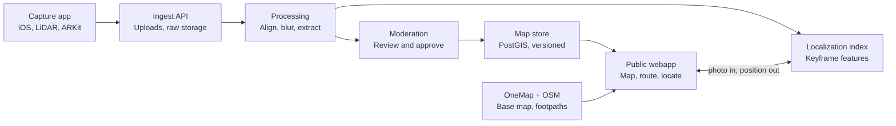
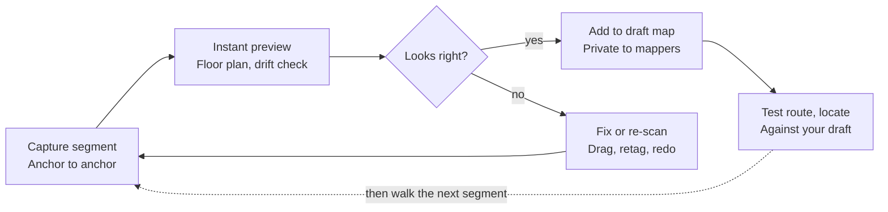

# Underground SG: indoor & underground wayfinding spec

Oct 12, 2026 · Josh Stout · Exported from the living doc: https://claude.ai/code/artifact/39b5bb53-40b8-4b46-ba9c-e6e1c3337f78
(This file is now the source of truth for the codebase. Keep it updated when decisions change.)

## Overview and goals

Underground SG is a free public webapp that shows downtown Singapore's underground pedestrian links (UPLs) and mall interiors on the real street map, tells you where you are, and routes you between two street-level points through the underground. Contributors capture the maps with iPhone LiDAR; edits go live only after moderation.

The gap: UPLs join MRT stations, malls and offices into one network, but no public map shows it as one network across levels. Street maps route on the surface, and mall directories stop at their own walls. A 2025 Hack for Public Good team, [Under Cover](https://www.hack.gov.sg/2025/under-cover/), showed clear demand in Orchard, but built its routes by hand.

MVP goals (targets to validate in the pilot):

- Map the City Hall cluster end to end: every public level, exit, escalator and lift.
- Locate a user on the correct level and within about 5 m from a single photo.
- Route between any two street points in the cluster, preferring underground or sheltered paths.
- Publish a contributor's edit within 48 hours of submission, after review.

## Users and core use cases

Five groups, two of them on the supply side.

| User | What they need | Feature that serves it |
| --- | --- | --- |
| Office workers and commuters | Fastest sheltered path between MRT, office and lunch | Street-to-street routing, "stay underground" toggle |
| Tourists | Find an exit or attraction without knowing mall names | Locate me, exits labelled with the street they open onto |
| Wheelchair users, parents with prams | Step-free routes, lift locations | Step-free routing mode |
| Contributors | Add a missing corridor or fix a closed exit | iPhone capture app, quick edits |
| Moderators | Keep the live map accurate and safe | Review queue, diff view, rollback |

## MVP scope: City Hall cluster

The MVP covers one dense, connected cluster you can walk daily, so drift, positioning and routing are tested on real ground before scaling.

Core venues (boundary to confirm on a site walk):

- City Hall MRT interchange, all public levels and exits
- Funan, including the UPL from its Basement 2 to City Hall station
- Raffles City
- CityLink Mall and its link to Esplanade MRT
- Esplanade MRT station exits

Stretch, if the core goes smoothly: Marina Square, Suntec City, Esplanade theatres.

In scope: public walkways, levels, exits, escalators, lifts, stairs, toilets, and shop names as points of interest. Street footpaths only where they join two exits.

Out of scope for MVP: a public native app, other clusters (Orchard, Raffles Place), live crowd levels, shop opening hours and inventory, back-of-house and restricted areas.

## System architecture

Scans flow one way, from the phone through processing to a moderator, and only approved versions reach the public map.

The webapp reads only published map versions and sends user photos to the localization index for a position. Quick status edits from users enter the same moderation queue.

## Capture app for contributors

Capture is a native iOS app, because a webpage cannot read the LiDAR sensor. The public map stays a webapp. For initial mapping, the same app also previews, edits and tests the map (see Mapper mode). It needs an iPhone Pro model with LiDAR.

How a capture works:

1. Pick or create a start anchor: a fixed, recognisable point such as an exit door, an escalator top or a fare gate.
2. Walk one short segment (one corridor, hall or level) at a steady pace, phone at chest height.
3. Tap to tag features as you pass them: exit, escalator, lift, stairs, toilet, door.
4. End on a second anchor. Every segment starts and ends on anchors, which is how segments join and how drift is corrected.
5. Review a quick preview, then queue for upload on Wi-Fi.

What each capture records: RGB keyframes, LiDAR depth, ARKit camera poses, IMU data, the ARKit scene mesh, and the tags with their positions. The exact bundle layout is in [capture-bundle.md](capture-bundle.md).

Privacy on the device: faces and screens are detected and blurred before anything is written to the upload bundle. Unblurred frames never leave the phone.

## Mapper mode: the fast loop

For initial mapping, capture, review and testing all happen in one app on the phone, so you catch a mistake while still standing in the corridor. The server still processes everything, but in the background, refining segments you have already accepted.

A segment that fails the preview is fixed or re-walked on the spot; one that passes joins your private draft and can be tested right away.

| Step | Runs on | Target time |
| --- | --- | --- |
| Live mesh and camera tracking while walking | Phone (ARKit) | Real time |
| Floor plan preview: floor surfaces flattened to a walkable outline over OneMap tiles | Phone | Seconds after the end anchor |
| Drift check: gap between where the end anchor should be and where the scan puts it | Phone | At the end anchor |
| Stitch into the draft and edit (move a node, retag, redraw an outline) | Phone | Immediate |
| Test a route or a photo locate against the draft | Phone | Immediate |
| Full refinement, final mesh, localization index | Server | Minutes, then synced back into the draft |

Details:

- ARKit's LiDAR mesh already labels surfaces as floor, wall, door and so on, which makes the on-device floor plan cheap to build.
- A coverage overlay marks unscanned gaps and low-confidence areas, so you know exactly what to re-walk.
- The draft map shows the refined version, once it arrives, beside your field version. You see where the server moved things.
- The map uses MapLibre Native with the webapp's style, so the phone shows what public users will see.
- An iPad Pro with LiDAR runs the same app and gives a bigger screen for review.
- Drafts stay private. You publish a batch once it passes testing; contributors' work still goes through the moderation queue.

## Processing pipeline

Each uploaded segment runs through eight steps on GPU workers, ending in the moderation queue. Nothing reaches the live map automatically.

1. **Ingest and validate:** check device, duration, and that both anchors are present.
2. **Privacy re-check:** run face and screen detection again server-side; reject the segment if anything was missed.
3. **Reconstruct:** refine camera poses with structure-from-motion and bundle adjustment, then fuse depth into a mesh.
4. **Align:** register the segment to its neighbours using shared anchors and overlapping imagery.
5. **Georeference:** fix anchors that face the street (exits) to surveyed coordinates from OneMap (SVY21), and pull the indoor network into place on the street map.
6. **Extract:** detect floor planes to assign levels, trace walkable area as polygons, derive centrelines as graph edges, and turn tags into nodes.
7. **Diff:** compare against the live map and produce a change set (added, moved, removed).
8. **Index for localization:** store keyframe features so the segment can be used for photo-based positioning once approved.

## Data model

The map is a graph of nodes and edges laid over level polygons, versioned as a whole. It is stored in PostGIS and kept close enough to Apple's IMDF that it can be exported to that format later. The draft schema is in [`db/schema.sql`](../db/schema.sql).

| Entity | Key fields | Notes |
| --- | --- | --- |
| Venue | id, name, owner, footprint polygon | A mall, station or link |
| Level | id, venue_id, ordinal, name ("B2") | Ordinal is shared across venues, so B2 means the same height everywhere |
| Space | id, level_id, polygon, kind (walkway, shop, plaza) | Drawn on the map |
| Node | id, level_id, point, kind (junction, exit, escalator, lift, stairs, gate) | Exits carry the street they open onto |
| Edge | from_node, to_node, length_m, step_free, sheltered, outdoor | Routing costs come from these flags |
| Anchor | id, node_id, surveyed_point, photo | Fixed points that join segments and tie them to OneMap |
| POI | id, space_id, name, category | Shops, toilets, ATMs |
| Capture | id, contributor_id, anchors, bundle_uri, status | Raw upload, kept private |
| ChangeSet | id, capture_id or edit, diff, track, reviewer, decision | One per submission |
| MapVersion | id, published_at, changeset_ids | Immutable; rollback means republishing an earlier version |
| Contributor | id, trust_tier, accepted_count, rejected_count | Drives which review track applies |

## Crowdsourcing and moderation

Contributions split into two tracks by how much they can break: structural changes always get a human review, while status updates can skip the queue once a contributor has earned trust.

| Track | Examples | Evidence required | Review |
| --- | --- | --- | --- |
| Structural | New corridor, changed layout, new exit or lift | A capture segment with both anchors | Always a moderator, with a side-by-side diff on the map |
| Status | Exit closed, escalator down, shop renamed | A photo or a short note | Moderator for new contributors; auto-publish for trusted ones, with spot checks |

Trust tiers:

- **New:** everything reviewed.
- **Trusted:** status edits auto-publish after a set number of accepted contributions with no recent rejections.
- **Moderator:** can approve others' work, never their own. The one exception is the project owner seeding the map in Mapper mode.

Versioning: every approval publishes a new immutable map version. A bad edit is undone by republishing the previous version, and the change set stays on record.

Moderators also reject anything showing restricted or back-of-house areas, even when the capture is good.

## Localization: where am I

Users are located by matching one camera photo against the approved scans, because GPS fails underground and iOS Safari cannot scan Wi-Fi or Bluetooth beacons. The scans contributors already collect double as the reference data, so positioning costs no extra survey work.

1. The user taps **Locate me**; the webapp opens the camera in the browser.
2. They point at the corridor ahead and take one photo. The app attaches hints: last known position, selected level, and compass heading if the user allows motion access.
3. The server finds candidate keyframes nearby by image similarity, then matches local features and solves for the camera pose.
4. It returns level, position and heading, with a confidence score.
5. Low confidence prompts the user to turn and try again, ideally facing a sign or shopfront.

Between photos, the dot stays at the last fix and the route stays on screen. Step counting from phone motion is an experiment for later, not an MVP feature.

Fallbacks: tap "I'm at" on a nearby landmark, or scan a QR code at major junctions if landlords agree to put them up.

Query photos are deleted as soon as the position is returned and never stored. Target response time is under 3 seconds.

## Map display and street-to-street routing

The indoor network is drawn as level layers over the OneMap street map and joined to street footpaths at every exit, so one route can start on one street, go underground, and come up on another.

Display:

- MapLibre GL JS renders OneMap base tiles with the indoor layers on top.
- A level switcher shows one level at a time; levels above and below fade out.
- Exits are labelled with the street or building they open onto, on both the indoor and street layers.

Routing:

- The street side uses OpenStreetMap pedestrian footpaths inside the cluster's bounding box. OneMap's routing API cannot take your indoor graph as input, so it is not used for routing.
- The two graphs share exit nodes, so the router sees one network.
- Edge cost is walking distance plus penalties: outdoor exposure (heavy when "stay underground" is on), stairs (excluded in step-free mode), and level changes.
- The cluster graph is small enough to route in the browser; move routing to the server (pgRouting) if the network grows past a few clusters.
- Directions are turn by turn, each step paired with a landmark photo taken from the captures.

## Tech stack

Python carries the backend because the 3D and vision tooling lives there; TypeScript carries the webapp.

| Layer | Choice | Why |
| --- | --- | --- |
| Capture app | Swift, ARKit, RealityKit, Apple Vision | Only native code can read LiDAR; Vision handles on-device face detection |
| API | Python, FastAPI | Same language as the processing code |
| Database | PostgreSQL with PostGIS | Spatial queries, graph storage, versioning |
| Raw storage | S3-compatible object storage | Capture bundles are large and private |
| Processing | Python workers on GPU instances, COLMAP, Open3D, job queue | Pose refinement, meshing, extraction |
| Localization | Image retrieval plus feature matching (hloc-style pipeline) | Proven approach for photo-to-pose; check each model's licence, as some are non-commercial |
| Webapp | Next.js, React, MapLibre GL JS | Fast mobile web, vector maps, client-side routing |
| Base data | OneMap tiles and coordinates, OpenStreetMap footpaths | Authoritative Singapore base map plus an open pedestrian network |
| Hosting | Cloud region in Singapore | Low latency, keeps personal data in country |

## Privacy, legal and permissions

Permission to scan is the main blocker, ahead of any technical risk, so outreach starts before the capture app is finished. This section is a checklist of issues to resolve, not legal advice; get a lawyer to review contributor terms and data licences before launch.

- **Landlords:** malls are private property. Ask each landlord (Funan, Raffles City, CityLink) for written permission to scan public areas. A public-good, non-commercial framing helps.
- **MRT stations:** ask the station operator and LTA. Expect stricter rules than in malls.
- **PDPA:** identifiable faces in captures are personal data. Blur on the device, re-check on the server, keep raw bundles private, and delete query photos straight away.
- **Contributor terms:** contributors confirm they had permission to scan, grant you a licence to their captures, and agree to the no-restricted-areas rule.
- **Map data licence:** combining OpenStreetMap data with your own can trigger OSM's share-alike licence (ODbL) on the combined database. Decide early whether to publish your map data under ODbL too.
- **OneMap terms:** confirm the terms of use and attribution for base tiles and APIs.
- **Security:** publish public walkways only. No plant rooms, service corridors or security features.

## Risks and open questions

The two risks that could stop the project are landlord refusal and positioning failing in corridors that look alike. The pilot is designed to test both early.

| Risk | Effect | Mitigation |
| --- | --- | --- |
| Landlords or operators refuse | Gaps in the network | Start with the venue most likely to say yes; offer them the map data back |
| Drift over long corridors | Segments misalign; routes cross walls | Short segments, anchors at both ends, measure drift in the pilot |
| Look-alike corridors | Wrong position, or no position | Use level and last-fix hints; ask the user to face a sign; QR fallback |
| Shopfronts change | Localization degrades, map goes stale | Status edits from users; re-scan busy segments on a schedule |
| Few contributors | Map stops growing | Seed the cluster yourself; recruit local mapping communities |
| Crowds block the view | Poor scans and failed localization | Capture early mornings; retry prompts for users |

Open questions:

- [ ] Side project, or pitched to an agency (SLA, URA, GovTech)? This changes how permissions and funding work.
- [ ] Which licence for the published map data?
- [ ] How do contributors sign in (email and passkeys, or Singpass)?
- [ ] Which stretch venues come after the core cluster?
- [ ] Who moderates at launch, and how many hours a week will it take?

## Milestones

The MVP runs in four phases, and each one moves on only after a test on the ground passes. Durations are left open until the side-project-or-agency question is settled.

| Phase | Work | Gate |
| --- | --- | --- |
| 1. Groundwork | Site walk of cluster; ask landlords, LTA; capture app prototype | One venue says yes |
| 2. Capture pilot | Scan Funan UPL; anchor to OneMap; measure drift | Segments align end to end |
| 3. Map and routing | Cluster graph; routing via UPLs; step-free mode | Routes verified on foot |
| 4. Locate and launch | Photo localization; contributor edits; moderation queue | Public beta goes live |

Phase 1's gate matters most because one landlord saying yes unblocks everything after it; the Funan UPL is a good first ask, since it is short, public and well defined.
